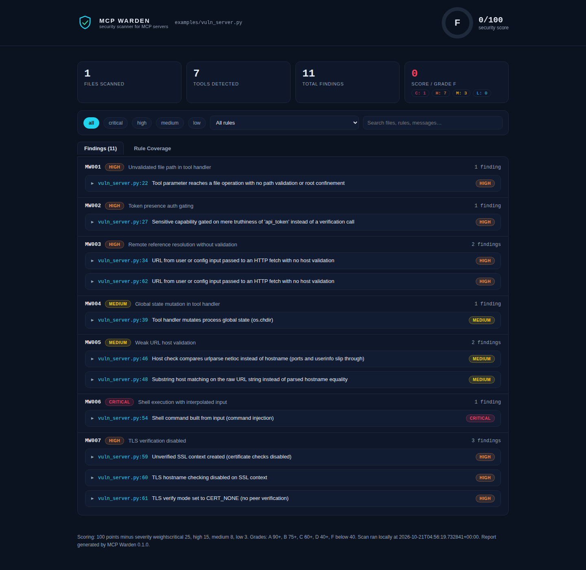
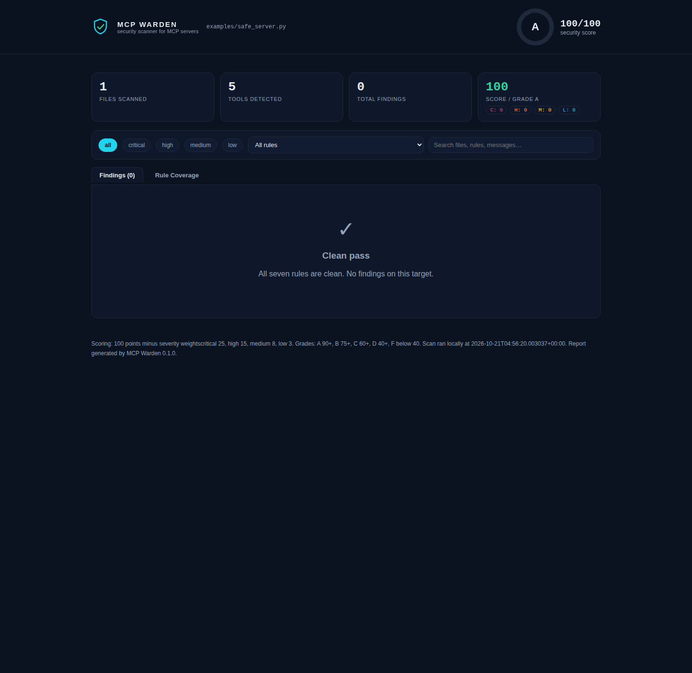

# MCP Warden

**A security scanner for Model Context Protocol (MCP) servers: seven AST rules, a scored report, and an interactive HTML dashboard.**


## Demo

Watch the demo video: [MCP Warden demo on YouTube](https://www.youtube.com/watch?v=QVmYLDrbAVQ). It walks through the vulnerable fixture scan, the interactive dashboard, and the clean pass on the hardened fixture.

## Why it matters

MCP servers hand AI agents real tools: read files, fetch URLs, run commands.
A vulnerable server turns the agent into a confused deputy, executing an
attacker's intent with the server's privileges. MCP Warden audits the server
code *before* deployment, confirms what it can with a safe local probe, and
issues a scored report with concrete remediation for every finding.

The scanner is pure Python standard library (`ast`, `json`, `subprocess`,
`argparse`). No third party runtime dependencies, and scans run entirely
locally: no code ever leaves the machine.

## Install

Python 3.11 or newer.

```bash
git clone https://github.com/coldrazer/mcp-warden.git
cd mcp-warden
pip install -e .
```

Or run without installing:

```bash
PYTHONPATH=src python -m mcpwarden scan <target>
```

## Quickstart

```bash
mcpwarden scan path/to/server.py                            # text report
mcpwarden scan path/to/server.py --format json -o report.json
mcpwarden scan path/to/server.py --format html -o dashboard.html
mcpwarden scan path/to/server.py --probe                    # local dynamic confirmation
mcpwarden scan path/to/servers/                             # scan a whole directory
```

Exit codes: **0** when the target is clean, **1** when findings exist,
**2** when the target does not exist. Files that cannot be parsed are
reported as skipped in the output, never silently counted as clean.

## Sample output

The bundled `examples/vuln_server.py` plants all seven weakness classes on
purpose. Excerpt from a real scan:

```
MCP WARDEN scan report
Target: examples/vuln_server.py
Score: 0/100  Grade: F
Files scanned: 1   Tools detected: 7   Findings: 11
By severity: critical: 1, high: 7, medium: 3

[CRITICAL] MW006 Shell execution with interpolated input
  examples/vuln_server.py:54  Shell command built from input (command injection)
    | proc = subprocess.run("ls " + cmd, shell=True, capture_output=True, text=True)
  Remediation: Never build shell strings from input. Pass argument lists to subprocess with shell disabled, and validate any parameter against an allowlist before use.

[HIGH] MW001 Unvalidated file path in tool handler
  examples/vuln_server.py:22  Tool parameter reaches a file operation with no path validation or root confinement
    | with open(path) as handle:
  Remediation: Resolve the path and require it to stay under an allowlisted root directory (for example pathlib resolve plus is_relative_to), or map the parameter through an explicit allowlist of permitted files.

...
```

The hardened `examples/safe_server.py` scans clean: score 100/100, grade A,
zero findings. Probe mode confirms the path traversal live against the local
fixture only:

```bash
$ mcpwarden scan examples/vuln_server.py --probe
Probe: confirmed
```

## The rules

Seven weakness classes distilled from a hands on audit of a widely used
production MCP server. Each rule carries an ID, a severity, and remediation
text that ships with every finding.

| ID | Rule | Severity | What it detects |
|----|------|----------|-----------------|
| MW001 | Unvalidated file path in tool handler | High | Tool parameter reaches a file operation with no path validation or root confinement |
| MW002 | Token presence auth gating | High | Sensitive capability gated on mere truthiness of a token instead of a verification call |
| MW003 | Remote reference resolution without validation | High | URL from user or config input passed to an HTTP fetch with no host validation (SSRF class) |
| MW004 | Global state mutation in tool handler | Medium | Tool handler mutates process global state (`os.chdir`, `sys.path`, `os.environ`) |
| MW005 | Weak URL host validation | Medium | Host check compares `netloc` instead of `hostname`, or substring matching on the raw URL string |
| MW006 | Shell execution with interpolated input | Critical | Tool input interpolated into a shell command string (command injection) |
| MW007 | TLS verification disabled | High | `verify=False`, unverified SSL contexts, or `CERT_NONE` |

## Scoring

Every server starts at 100 points. Each finding subtracts its severity
weight, floored at 0:

| Severity | Weight |
|----------|--------|
| Critical | 25 |
| High | 15 |
| Medium | 8 |
| Low | 3 |

Grades: **A** 90+, **B** 75+, **C** 60+, **D** 40+, **F** below 40.

## Dashboard

`--format html` writes a single self contained report file. The scan results
are embedded as JSON and rendered by React 18 plus htm (loaded from the unpkg
CDN at view time; no build step) with severity and rule filters, free text
search, expandable finding rows with evidence and remediation, a Findings /
Rule Coverage tab switch, an animated SVG score ring with letter grade, and
KPI cards. If the CDN is unreachable, the file falls back to a plain message
and the embedded JSON remains readable.

The vulnerable fixture: 11 findings, score 0, grade F.



The safe fixture: a clean pass, score 100, grade A.



## Documentation

- [docs/ARCHITECTURE.md](docs/ARCHITECTURE.md): threat model and pipeline diagram
- [docs/DEVPOST.md](docs/DEVPOST.md): project pitch and submission text
- [docs/DEMO-SCRIPT.md](docs/DEMO-SCRIPT.md): 3 to 5 minute demo narration

## Project layout

```
src/mcpwarden/
  __main__.py    CLI: scan TARGET [--format text|json|html] [--probe]
  engine.py      target walking, per file scanning, tool detection
  detectors.py   the seven AST rule detectors
  rules.py       rule catalog, severities, weights
  score.py       100 point scoring and letter grades
  report.py      text, JSON, and HTML dashboard rendering
  probe.py       local only stdio probe for traversal confirmation
examples/
  vuln_server.py deliberately vulnerable MCP style server (all 7 classes)
  safe_server.py hardened equivalent (zero findings)
tests/           pytest suite: every rule fires on vuln, none on safe
docs/
  ARCHITECTURE.md  threat model and pipeline diagram
  DEVPOST.md       submission pitch text
  DEMO-SCRIPT.md   3 to 5 minute video narration
```

## Open source used

Declared in full: the scanner itself uses only the Python standard library.
The generated HTML dashboard loads React 18, ReactDOM 18, and htm 3 from the
unpkg CDN at view time and embeds the scan results as JSON. The pytest suite
(17 tests, all passing) is the only dev dependency.

## License

Copyright 2026 Christopher Guerrero and Apex Studio LLC.

Licensed under CC BY-NC 4.0 (Creative Commons Attribution NonCommercial 4.0 International): noncommercial use with attribution is permitted, and commercial use is not. See [LICENSE](LICENSE) for the full legal text.
