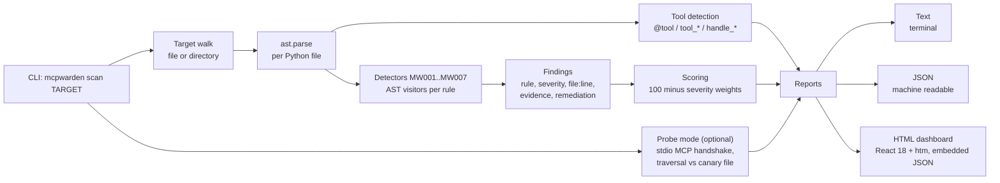

# MCP Warden architecture

## Threat model

An MCP server sits between an AI agent and the host system. The agent
chooses tool calls and fills in their parameters; the server executes them
with its own OS privileges. The attacker in this model is anyone who can
influence a tool parameter: a malicious user chatting with the agent, a
poisoned document the agent reads, or a compromised upstream tool in a
multi server setup. The defender controls the server code and its
deployment configuration.

The scan assumes the attacker controls parameter *values* but not the
server source. Each rule therefore tracks the same question: does an
attacker influenced value reach a dangerous sink without a check in
between?

| Rule | Attack vector it closes |
|------|-------------------------|
| MW001 unvalidated file path | Path traversal: `read_file("../../../../etc/passwd")` escapes the data directory and exfiltrates host files through the agent. |
| MW002 token presence gating | Auth bypass: any nonempty string unlocks admin capabilities, so the agent's tool becomes an open admin API. |
| MW003 unvalidated remote reference | SSRF: a config or user supplied URL makes the server fetch internal endpoints (cloud metadata, intranet) and return the response to the attacker. |
| MW004 global state mutation | Cross request interference: `os.chdir` in one handler changes the working directory for every concurrent request, breaking path assumptions and sandboxing elsewhere. |
| MW005 weak host validation | Allowlist bypass: `netloc` includes ports and userinfo, and substring matching accepts `trusted.example.evil.com`, so the SSRF allowlist is decorative. |
| MW006 shell interpolation | Command injection: a parameter interpolated into a shell string runs arbitrary commands as the server user, full host compromise. |
| MW007 TLS disabled | Traffic interception: with verification off, any network adversary between the server and its upstream reads and rewrites API traffic. |

Out of scope for the static pass: vulnerabilities that only manifest at
runtime with specific data (race windows narrower than the chdir class,
dependency confusion in requirements files), and MCP protocol level issues
in the SDK itself. Probe mode covers the one dynamic check that is safe to
run locally: confirming that a path traversal payload actually escapes the
fixture root, using a canary file the probe creates and deletes itself.

## Pipeline

## Detector design

Each detector is a small AST visitor, deliberately narrow so the hardened
fixture stays at zero findings:

* **MW001** finds `open` / `Path` / `send_file` style sinks whose arguments
  contain a handler parameter name (or a local variable assigned from
  one), unless the same function calls `is_relative_to`, `commonpath`,
  `realpath`/`resolve`, or tests the parameter against an allowlist
  container.
* **MW002** finds `if token:` style truthiness gates that `return` data,
  where no call to a `verify*` / `authenticate*` / `validate*` function
  touches the token in the same handler.
* **MW003** finds `requests` / `httpx` / `urlopen` calls whose URL argument
  is a parameter, subscript, or attribute (config references count), or a
  local variable assigned from one of those, rather than a literal,
  unless the handler parses the URL and checks `hostname`.
* **MW004** finds `os.chdir`, `sys.path` mutation, and `os.environ` writes
  inside any function body.
* **MW005** finds `==` comparisons against `.netloc`, and `in` tests of a
  host string against a URL variable (substring matching).
* **MW006** finds subprocess / `os.system` calls where the command is an
  f-string, `.format()`, or string concatenation over parameters, or where
  `shell=True` meets a non literal command.
* **MW007** finds `verify=False`, `ssl._create_unverified_context()`,
  `CERT_NONE`, and `check_hostname = False`.

Findings carry the exact source line as evidence plus the rule's remediation
text, so the report is actionable without opening the code.

## Scoring

Severity weights: critical 25, high 15, medium 8, low 3. Score starts at
100, subtracts the weights of all findings, floors at 0. Grades: A 90+,
B 75+, C 60+, D 40+, F below 40. The weights make one critical (shell
injection) worse than three mediums, which matches how these bugs behave
in practice.
